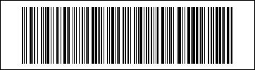

# Barcode Scanning

The `barcode` module detects machine readable codes (barcodes and QR codes) on both platforms, like VisionCamera's
`react-native-vision-camera-barcode-scanner`. It offers a `CodeScanner` view, a barcode scanner `CameraOutput`, a
`BarcodeScanner` to use in a Frame Processor, and still image scanning.

```kotlin
dependencies {
    implementation("me.nathanfallet.visioncamera:barcode:1.0.0")
    // For the Compose helpers (CodeScanner, rememberBarcodeScanner, rememberBarcodeScannerOutput):
    implementation("me.nathanfallet.visioncamera:barcode-compose:1.0.0")
}
```

On Android, codes are scanned with [ML Kit](https://developers.google.com/ml-kit/vision/barcode-scanning), like in
VisionCamera. On iOS, they are scanned with Apple's [Vision](https://developer.apple.com/documentation/vision)
framework, which is built into the system: there is nothing to add to your app (no pod, no model), and the results are
mapped to match ML Kit's (formats, value types, display values and coordinates). Test scanning on a device: some iOS
Simulators detect no codes with Vision.

Unlike [the Object Output](object-output.md) (which is iOS-only), the barcode scanner works on both iOS and Android.

## Using the barcode scanner

### The `CodeScanner` view

`CodeScanner` is a Camera view that scans codes with the default back camera:

```kotlin
CodeScanner(
    isActive = isActive,
    barcodeFormats = listOf(TargetBarcodeFormat.ALL_FORMATS),
    onBarcodeScanned = { barcodes -> println("Scanned ${barcodes.size} barcodes!") },
    onError = { error -> println("Error scanning barcodes: $error") },
    modifier = Modifier.fillMaxSize(),
)
```

### A camera output

For more control over the `Camera` or the `CameraSession`, create a barcode scanner `CameraOutput` and attach it like
any other output:

```kotlin
val barcodeOutput = rememberBarcodeScannerOutput(
    barcodeFormats = listOf(TargetBarcodeFormat.ALL_FORMATS),
    onBarcodeScanned = { barcodes -> println("Scanned ${barcodes.size} barcodes!") },
    onError = { error -> println("Failed to scan barcodes! $error") },
)
Camera(device = TargetCameraPosition.BACK, isActive = true, outputs = listOf(previewOutput, barcodeOutput))
```

Without Compose, create it with `createBarcodeScannerOutput(BarcodeScannerOutputOptions(...))`, and `dispose()` it
when you no longer need it.

`outputResolution` chooses the size of the scanned buffers: `BarcodeScannerOutputResolution.PREVIEW` (the default)
prefers preview-sized buffers for lower latency, `FULL` the largest available buffers for small or dense codes.

### In a Frame Processor

For full control, scan the `Frame`s of a [frame output](frame-output.md) yourself with a `BarcodeScanner`:

```kotlin
val barcodeScanner = rememberBarcodeScanner(barcodeFormats = listOf(TargetBarcodeFormat.ALL_FORMATS))
val frameOutput = rememberFrameOutput(FrameOutputOptions(pixelFormat = TargetVideoPixelFormat.YUV)) { frame ->
    frame.use {
        val barcodes = barcodeScanner.scanCodes(frame)
        println("Detected ${barcodes.size} barcodes!")
    }
}
```

`scanCodes` runs synchronously on the frame's thread. Use `scanCodesAsync(frame)` to suspend instead. Without Compose,
create the scanner with `createBarcodeScanner(BarcodeScannerOptions(...))`.

### Still images

To scan a still `Image` (from `photo.toImage()`, `Bitmap.toImage()` on Android or `UIImage.toImage()` on iOS), use
`scanCodesInImageAsync`:

```kotlin
createBarcodeScanner(BarcodeScannerOptions(listOf(TargetBarcodeFormat.ALL_FORMATS))).use { scanner ->
    val barcodes = scanner.scanCodesInImageAsync(image)
    println("Detected ${barcodes.size} barcodes!")
}
```

## Configuring barcode formats

The examples above detect **all** formats. To improve performance, narrow `barcodeFormats` down to the formats you
need, for example `TargetBarcodeFormat.CODE_128`, a common barcode format, or `TargetBarcodeFormat.QR_CODE` for square
QR codes.

## A barcode

Every `Barcode` has:

- its `format` (a `BarcodeFormat`), and its `valueType` (URL, Wi-Fi, phone, contact info…).
- its `rawValue` and `rawBytes`, and a human-friendly `displayValue` (e.g. the network name of a Wi-Fi code).
- its `boundingBox` and its four `cornerPoints` (top-left, top-right, bottom-right, bottom-left).

Codes scanned in a `Frame` (by the output or `scanCodes`) have their coordinates in the frame's buffer coordinate
system. To draw them over the preview, convert them to camera coordinates with `frame.convertFramePointToCameraPoint`,
then to view coordinates with the preview's `convertCameraPointToViewPoint`. Codes scanned in an `Image` have their
coordinates in the upright image, in pixels.

## Test it

Try scanning this example Code 128 barcode:



*Image from the [VisionCamera documentation](https://visioncamera.margelo.com/docs/barcode-scanner), MIT licence.*
